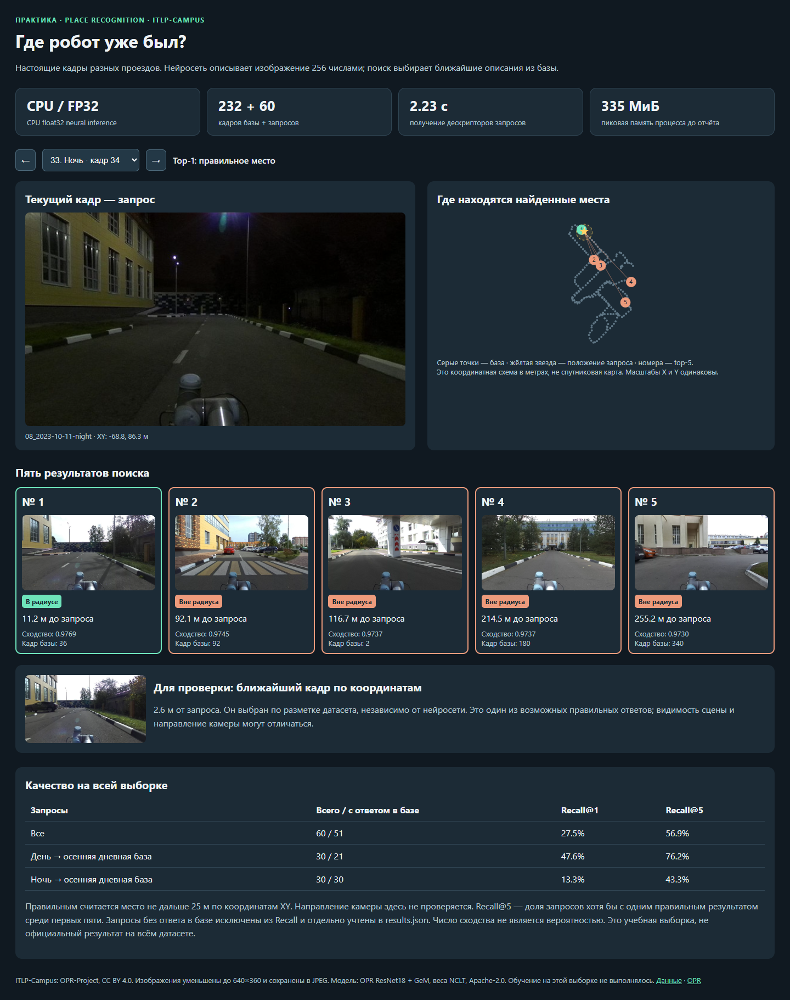
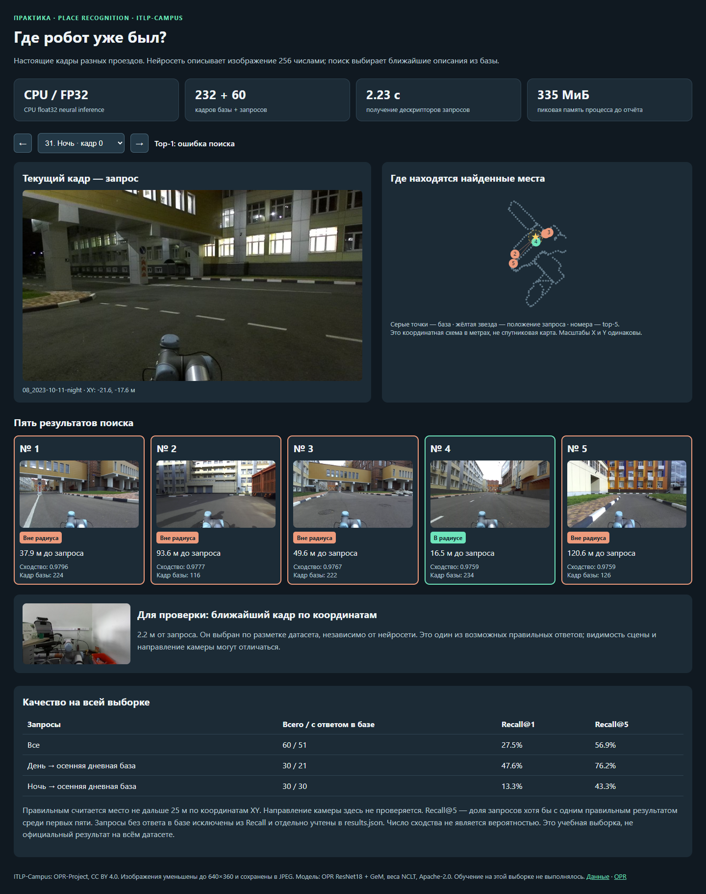

# Проверка CPU: фактические результаты

Проверено 6 ноября 2026 г. на ноутбуке преподавателя. Это измерения конкретного компьютера, не гарантия такого же времени на любом ноутбуке.

## Окружение

- Intel Core Ultra 7 155U, 12 физических ядер / 14 логических процессоров.
- Windows 11, Python 3.12.14, отдельное новое `.venv`, установленное из `requirements.txt`.
- PyTorch **2.7.1+cpu**, torchvision **0.22.1+cpu**. GPU не используется.
- 4 потока PyTorch, batch size 1, float32, изображение 320×192.
- ResNet18 + GeM из OPR; готовые веса NCLT; 2 848 577 параметров, 256 чисел на изображение. `load_state_dict(..., strict=True)` прошёл без пропущенных/лишних ключей.
- 232 кадра базы и 60 запросов из других проездов. Все 292 изображения действительно прошли через модель при полном тесте. Полный OPR с лидарными и GPU-компонентами не устанавливался: проверен поставляемый CPU-адаптер этой модели.

## Время и память

| Режим | База через модель | Запросы через модель | Полное время скрипта с HTML | Пик RSS процесса |
|---|---:|---:|---:|---:|
| Полный пересчёт в новом окружении | 9.16 с / 232 кадра | 2.33 с / 60 кадров | **18.17 с** | **482 МиБ** |
| Обычный студенческий запуск | Из кэша | 2.31 с / 60 кадров | **6.76 с** | **482 МиБ** |
| Резерв: все дескрипторы из кэша, радиус 10 м | Из кэша | Из кэша | **0.71 с** | **188 МиБ** |

Первый пробный полный прогон в ранее существовавшем окружении занял 19.17 с, пик 483 МиБ. После этого выполнен полный прогон в новом окружении; цифры основного отчёта взяты из него.

Дополнительно проверен обычный запуск из отдельной копии студенческой папки с заполненным `student.py`, без аргумента `--implementation`: 9.43 с, 483 МиБ. Поэтому для демонстрации разумно ориентироваться на 7–10 с на данном ноутбуке, а не на единственное лучшее измерение.

Медианное время загрузки/предобработки/инференса одного изображения в чистом полном прогоне — **38.84 мс**, 95-й процентиль — **43.50 мс**. Импорт и загрузка модели — 5.35 с; прогрев одним кадром — 0.073 с. Сам поиск для всех 60 запросов — около 0.002 с.

Память: RSS процесса Python, опрос раз в 20 мс и сравнение с Windows `peak_wset`; итоговый пик включает создание автономного HTML с изображениями. Память браузера и других приложений не входит. Карточка в сгенерированном студенческом HTML фиксирует пик **до формирования отчёта**; окончательный пик с отчётом записан в `results.json`. Запуски были новыми процессами, но дисковый кэш Windows не сбрасывался. Время установки пакетов и скачивания данных не включено. Скачивание выбранных оригиналов ITLP заняло около 6 минут; студентам они уже выданы в уменьшенном виде.

## Что получилось по качеству

Правильное место — расстояние XY не больше 25 м. Направление камеры не учитывается. Дневные запросы из августа, база из октября: меняется не только время суток.

| Запросы | С ответом в базе / всего | Recall@1 | Recall@5 |
|---|---:|---:|---:|
| Дневные | 21 / 30 | 47.62% | 76.19% |
| Ночные | 30 / 30 | 13.33% | 43.33% |
| Все | 51 / 60 | 27.45% | 56.86% |

У 9 дневных запросов нет ни одного кадра базы в радиусе 25 м: они не включены в знаменатель Recall. Доля покрытия — 51/60 = 85%. Это не скрытые ошибки распознавания: для них невозможно найти допустимое совпадение в данной базе. Они остаются в визуализации с соответствующей пометкой.

При радиусе 10 м оцениваются 50/60 запросов; Recall@1 = 22%, Recall@5 = 44%. Ранжирование фотографий идентично: изменилось правило проверки и число запросов с допустимым ответом.

Модель слабо переносится на ночные кадры. Мы оставили ошибки в задании намеренно: практика учит измерять качество и объяснять ограничения. Это не обещание надёжной локализации и не официальный benchmark OPR.

## Выполненные проверки

- Установка в новое виртуальное окружение, `pip check` без конфликтов.
- Полный пересчёт базы и запросов на CPU; затем отдельный запуск с кэшем базы и повторным инференсом запросов.
- Контрольные суммы всех изображений и привязка кэша к весам, манифесту, модели и предобработке.
- Совпадение ранжирования во всех трёх режимах; метрики полного и обычного прогонов совпали.
- Эталонное заполнение двух студенческих функций прошло `check_student.py`; решение хранится у преподавателя и в эту папку не входит.
- В браузере проверены все 60 запросов: изображения, пять результатов, переключение, отсутствие ошибок JavaScript, мобильная ширина 390 px.
- Windows проверен непосредственно. Linux-команды документированы, но на Linux этот комплект пока отдельно не запускался.

Полные результаты: [полный CPU-прогон](demo/results.json), [обычный студенческий режим](demo/student_cpu.json), [радиус 10 м, резервный режим](demo/radius10.json).

## Посмотреть

Откройте `demo/index.html` из скачанной папки. Переключатель содержит все запросы, включая неудачные. GitHub показывает HTML как исходный код; для интерактивного просмотра скачайте папку. Статические примеры:

