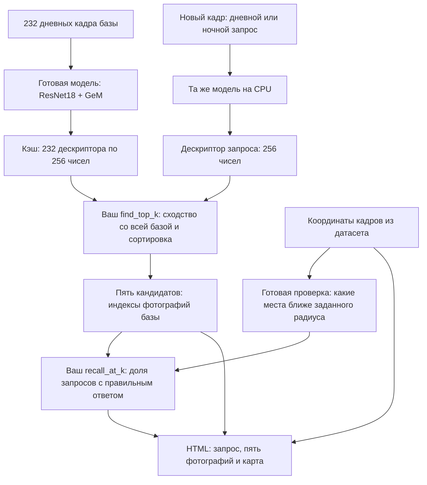

# Практика 3. Распознавание места по изображению — ITLP-Campus, CPU

Робот раньше проезжал по кампусу днём. По новой фотографии нужно найти, где он находится, и проверить, насколько надёжно работает поиск ночью.

Нейросеть и математическая часть извлечения признаков готовы. Вы пишете поиск по базе и расчёт качества. GPU, Docker, ROS, X11 и обучение нейросети не нужны.

## Какие данные используем

**ITLP-Campus Outdoor** — записи поездок робота Husky по университетскому кампусу. В полном датасете есть камеры, лидар и положения робота. В нашей работе используются только **цветные изображения передней камеры и координаты XY** из файлов `track.csv`.

| Роль | Проезд | Что входит в учебный комплект |
|---|---|---|
| База знакомых мест | `07_2023-10-04-day`, осенний день | 232 изображения: каждый второй кадр проезда |
| Дневные запросы | `05_2023-08-15-day`, летний день | 30 кадров, равномерно выбранных по индексам |
| Ночные запросы | `08_2023-10-11-night`, осенняя ночь | 30 кадров, равномерно выбранных по индексам |

В комплекте **292 настоящих изображения**, уменьшенных до 640×360. Перед нейросетью каждое приводится к размеру 320×192. Отбор выполнен заранее, независимо от того, успешно ли модель узнаёт эти места.

**База** — фотографии мест, которые робот уже видел. **Запрос** — новая фотография, для которой нужно найти похожее место в базе. База и запросы взяты из разных поездок: поиск не может просто вернуть тот же самый файл.

**Координаты не поступают в нейросеть и не используются для выбора результатов.** Они нужны после поиска: проверить, действительно ли найденный кадр снят рядом с запросом, и показать точки на схеме. Изображения, их координаты, проезды и ссылки на оригиналы перечислены в `data/manifest.json`.

## Какой алгоритм используем

Это **поиск ближайших изображений по нейросетевым дескрипторам**. Он состоит из двух разных частей: готовая модель описывает изображение числами, а ваш код сравнивает эти описания и выбирает наиболее похожие.

Модель — **ResNet18 + GeM из OpenPlaceRecognition (OPR)**. Веса уже обучены авторами на другом датасете — **NCLT**. В этой практике мы их не обучаем и не дообучаем на ITLP-Campus.

1. **Подготовка изображения.** Загружаем RGB-кадр, уменьшаем до 320×192 и нормируем значения цветовых каналов так, как ожидает модель.
2. **ResNet18 извлекает признаки.** Свёрточная нейросеть преобразует пиксели в пространственную карту признаков: числовые отклики на элементы внешнего вида сцены. Это не список подписанных объектов вроде «дом» или «дорога».
3. **GeM собирает карту в один вектор.** Generalized Mean Pooling — обобщённое усреднение: оно объединяет отклики по всему изображению, придавая сильным откликам больший вес. В нашем варианте OPR получается **256 чисел** — глобальный дескриптор кадра. Формулу и код этого слоя писать не нужно.
4. **Нормируем длину вектора до единицы.** После этого сходство двух дескрипторов можно считать скалярным произведением — это косинусное сходство. Чем оно больше, тем ближе описания. Дескриптор не содержит координаты робота и не гарантирует совпадение мест.
5. **Сравниваем запрос со всей базой.** Ваш `find_top_k` вычисляет сходство с каждым из 232 дескрипторов, сортирует результаты по убыванию и возвращает индексы первых `k`. Это полный перебор небольшой базы; FAISS, отдельный сервер и обучение для него не нужны.

Например, если сходство запроса с тремя фотографиями равно 0.93, 0.98 и 0.90, сначала нужно вернуть вторую фотографию, затем первую. Число 0.98 **не означает 98% вероятности правильного ответа**. Похожие здания могут дать ложное совпадение; ночная съёмка может сильно изменить описание знакомого места.

Используется конкретная компактная реализация OPR: укороченный backbone ResNet18 с 256 выходными каналами и GeM, а не классификатор, предсказывающий название объекта. В `model.py` и `third_party/opr_resnet.py` эта часть уже готова.

## Как устроен пайплайн



В обычном запуске дескрипторы базы уже рассчитаны, а **все 60 запросов действительно проходят через модель на CPU**. Модель и предобработка для базы и запросов одинаковы. `--rebuild-db` также пересчитывает базу; `--cached` берёт из кэша обе стороны и вообще не запускает нейросеть. Поиск и оценка вашим кодом выполняются во всех режимах.

Последний этап отделён от поиска: программа берёт координаты и помечает найденный кадр правильным, если он не дальше заданного радиуса от запроса. Затем ваш код считает Recall@K. Здесь не вычисляются точная поза камеры или ориентация робота: найденная фотография — кандидат на знакомое место.

## Что лежит в комплекте

- `student.py` — **единственный файл, который нужно дописать**: две функции.
- `model.py`, `third_party/` — готовая модель OPR ResNet18 + GeM на CPU.
- `weights/` — готовые веса NCLT, около 11 МБ.
- `data/` — изображения, координаты, описание выборки и предварительно рассчитанные дескрипторы.
- `run_lab.py` — получение дескрипторов запросов, вызов вашего поиска и создание отчёта.
- `check_student.py` — маленькие проверки ваших функций.
- `BENCHMARK.md` — условия и результаты реально выполненной проверки.
- `demo/index.html` — готовый отчёт преподавателя, можно открыть до написания кода.

Исходные данные и лицензии: [SOURCES.md](SOURCES.md). Мы используем компактную адаптацию одной модели OPR, а не устанавливаем весь исследовательский пакет.

## До занятия: установка

Скачайте репозиторий через **Code → Download ZIP** или `git clone --depth 1`. Откройте терминал в `practices/03-place-recognition`. Весь учебный набор и веса входят в папку; Hugging Face на занятии не нужен.

Нужен **64-битный Python 3.11 или 3.12**. Полный запуск проверен на Windows с Python 3.12. Для Linux x86-64 и macOS приведены отдельные команды; на этих ОС запуск преподавателем пока не проверен. `requirements-lock-windows-py312.txt` фиксирует проверенное Windows-окружение и не предназначен для Mac.

Windows PowerShell:

```powershell
py -3.12 -m venv .venv
.\.venv\Scripts\python.exe -m pip install -r requirements.txt
```

Linux x86-64:

```bash
python3.12 -m venv .venv
.venv/bin/python -m pip install -r requirements.txt
```

macOS — **Apple Silicon или Intel**:

```bash
python3.12 -m venv .venv
.venv/bin/python -m pip install -r requirements-macos.txt
.venv/bin/python -c "import platform, torch, torchvision; print(platform.machine(), torch.__version__, torchvision.__version__)"
```

На Apple Silicon используйте нативный Python (`arm64`), а не Python под Rosetta. Файл автоматически выбирает PyTorch 2.7.1 / torchvision 0.22.1 для Apple Silicon и PyTorch 2.2.2 / torchvision 0.17.2 с NumPy 1.26.4 для Intel. Для этих сочетаний проверено наличие готовых macOS-пакетов для Python 3.11/3.12; это **не заменяет проверку реального запуска на Mac**. Для ARM-пакетов нужен macOS 11 или новее. Источник сочетаний версий: [официальная страница PyTorch](https://pytorch.org/get-started/previous-versions/).

Суффикс `+cpu` используется в Windows/Linux-пакетах из отдельного индекса; macOS-пакеты устанавливаются без него. В коде устройство явно выбрано как `cpu`, поэтому на Mac также используется процессор, а не MPS/GPU. Результаты могут немного различаться между версиями PyTorch и платформами.

Активация окружения не требуется. Ниже команды показаны для Windows; **на Linux и macOS** замените `.\.venv\Scripts\python.exe` на `.venv/bin/python`. Например, основной запуск на Mac после заполнения `student.py`:

```bash
.venv/bin/python check_student.py
.venv/bin/python run_lab.py --out output/attempt01
open output/attempt01/index.html
```

Установку выполните **до пары**: скачивание PyTorch зависит от сети. Ориентир для подготовки компьютера: 8 ГБ RAM и 2 ГБ свободного диска; фактический расход процесса см. в BENCHMARK.md. Не устанавливайте CUDA.

## Шаг 1. Посмотреть пример

Откройте `demo/index.html` двойным щелчком. Переключите несколько дневных и ночных запросов. Сверху — изображение, для которого ищем место. Ниже — пять найденных фотографий; на схеме — реальные координаты запроса и найденных кадров.

**Дескриптор** — 256 чисел, описывающих изображение. Модель уже обучена. Близкие по смыслу изображения должны иметь похожие дескрипторы, но ошибки возможны.

**База** содержит кадры одного проезда, **запросы** — двух других. Один и тот же кадр не может искать сам себя. Координаты используются только для оценки и визуализации, не для поиска нейросетью.

## Шаг 2. Написать поиск

Откройте `student.py`, функцию `find_top_k`.

Вход:

- `query`: один дескриптор, массив формы `(256,)`;
- `database`: дескрипторы всех фотографий базы, массив `(N, 256)`;
- `k`: сколько результатов вернуть.

Все векторы уже нормированы. Их сходство можно получить скалярным произведением. Чем **больше** сходство, тем ближе описания. Верните **индексы**, а не изображения и не сами значения сходства; самый похожий результат должен идти первым. Используйте NumPy; пригодится `np.argsort`. Сходство не является вероятностью правильного ответа.

## Шаг 3. Написать оценку качества

Допишите `recall_at_k` в том же файле.

- `predictions` — для каждого запроса пять найденных индексов, форма `(Q, 5)`.
- `positives` — таблица `(Q, N)`: `True` означает, что кадр базы находится не дальше заданного радиуса от запроса.
- Для каждого запроса проверьте, есть ли **хотя бы один** правильный результат среди первых `k`.
- Верните долю успешных запросов от 0 до 1.

Пример: из 10 запросов у 7 правильное место оказалось в первой пятёрке. Recall@5 = 0.7. Это не означает, что 70% всех найденных фотографий правильные.

Запустите проверки:

```powershell
.\.venv\Scripts\python.exe check_student.py
```

## Шаг 4. Выполнить запуск на CPU

```powershell
.\.venv\Scripts\python.exe run_lab.py --out output/attempt01
```

Скрипт действительно пропускает все изображения запросов через нейросеть **на CPU**. Дескрипторы базы берёт из готового кэша. Откройте `output/attempt01/index.html` двойным щелчком: сервер и интернет не нужны. `results.json` содержит метрики, время, пиковую память и все результаты поиска.

Если компьютер слабый, используйте явно обозначенный резервный режим:

```powershell
.\.venv\Scripts\python.exe run_lab.py --cached --out output/cached
```

Здесь нейросеть **не запускается**, используются готовые дескрипторы запросов; ваш поиск и расчёт метрик всё равно выполняются. В отчёте режим подписан. Это резерв, а не измерение скорости инференса.

## Шаг 5. Провести эксперимент

1. Сравните Recall@1 и Recall@5 отдельно для дня и ночи.
2. Найдите один успешный и один ошибочный запрос. Объясните, какие детали сцены помогли или помешали поиску.
3. Повторите оценку с более строгим радиусом:

```powershell
.\.venv\Scripts\python.exe run_lab.py --cached --radius 10 --out output/radius10
```

Изменились ли сами найденные фотографии? Почему изменилась оценка? Радиус в метрах относится к проверке по координатам, а не к алгоритму поиска. Если у запроса нет ни одного кадра базы в радиусе, он исключается из Recall и учитывается отдельно. Сравните также число оцениваемых запросов.

Ночной и дневной проезды отличаются не только освещением: меняются сезон, окружающие объекты и ракурс. Поэтому не объясняйте любую разницу только ночью.

## Что сдавать

Предоставьте:

- ваш `student.py`;
- `results.json` основного запуска и запуска с радиусом 10 м;
- два скриншота: успешное и ошибочное совпадение;
- короткие ответы: что такое дескриптор; чем Recall@1 отличается от Recall@5; почему первый найденный кадр может быть неправильным; что изменилось при радиусе 10 м.

Укажите, использовался ли CPU-инференс или резервный кэш. Балльной разбивки нет. Результат принимается, когда функции проходят проверки, отчёт построен, а выводы согласуются с показанными примерами.

## Дополнительно: пересчитать всю базу

```powershell
.\.venv\Scripts\python.exe run_lab.py --rebuild-db --threads 4 --out output/full_cpu
```

Это полный прогон изображений базы и запросов через нейросеть. `--threads 2` позволяет проверить влияние числа потоков CPU.

## Границы задачи

Результат поиска — кандидат на знакомое место, не точная поза камеры. В этой работе нет вычисления ориентации, геометрической проверки и безопасного решения о замыкании петли SLAM. Данная метрика использует расстояние XY без проверки направления камеры. Небольшая учебная выборка не заменяет официальный benchmark.
